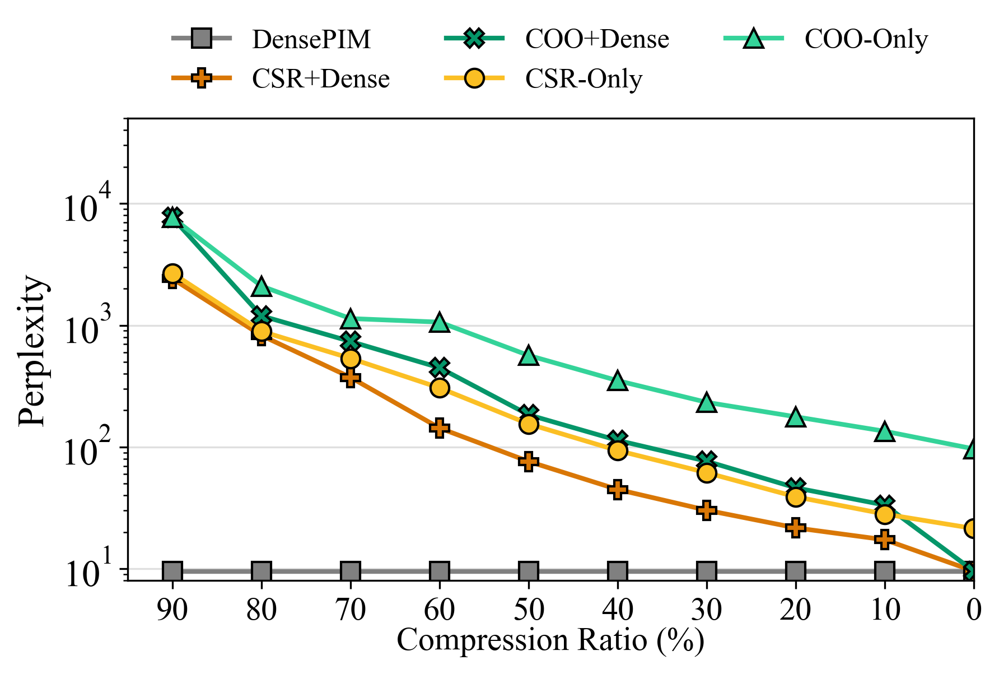
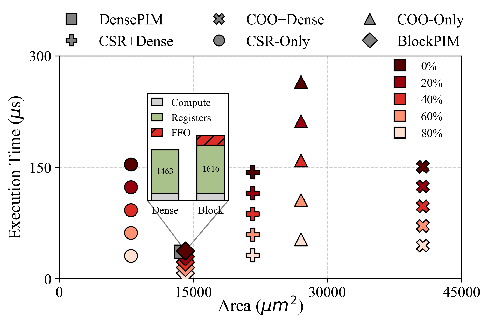
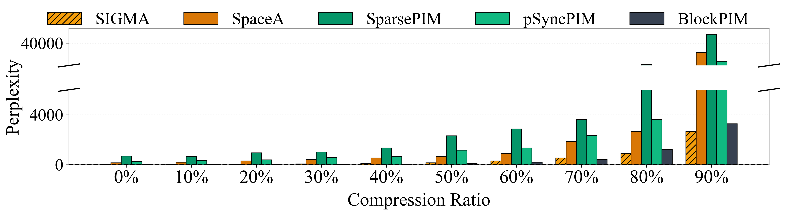
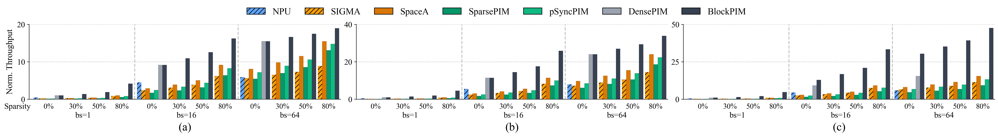
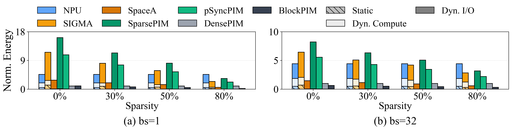

# BlockPIM: Enabling Sparse LLM Inference on Dense PIM Architectures

[](https://ieeexplore.ieee.org/document/11616633/)
[](https://doi.org/10.1109/LCA.2026.3715204)

This repository contains the official implementation and artifact of **BlockPIM**,
published in **IEEE Computer Architecture Letters (CAL), 2026**.

> **BlockPIM: Enabling Sparse LLM Inference on Dense PIM Architectures**<br>
> Seulki Kim<sup>1</sup>, Yewon Jang<sup>2</sup>, Yunhyeong Jeon<sup>1</sup>, Kyeonghyeon Ryu<sup>1</sup>, Daehoon Kim<sup>2</sup><br>
> <sup>1</sup>DGIST, <sup>2</sup>Yonsei University<br>
> *IEEE Computer Architecture Letters*, vol. 25, no. 2, pp. 311–314, July 2026<br>
> [[IEEE Xplore]](https://ieeexplore.ieee.org/document/11616633/) [[DOI]](https://doi.org/10.1109/LCA.2026.3715204) [[Project Page]](https://caslab-yonsei.github.io/publications/cal26-2-skim/)

## Abstract

Large Language Models (LLMs) have intensified the memory wall during inference,
where performance is increasingly limited by memory bandwidth rather than
computation. While Processing-In-Memory (PIM) and model compression techniques
mitigate this issue, existing sparse PIM designs rely on CSR/COO formats that
assume ultra-high sparsity (e.g., > 90%), which is difficult to achieve in
practical LLMs without significant accuracy loss. Moreover, fine-grained indexing
introduces substantial metadata overhead, diminishing the benefits of pruning,
especially under low-bit quantization. To address this mismatch, we propose
BlockPIM, a PIM architecture that employs hardware-aligned coarse-grained pruning
to efficiently execute sparse LLMs on standard dense computation units. BlockPIM
replaces per-element indices with compact bitmaps and contiguous non-zero blocks,
enabling sparse workloads to be processed directly on dense execution pipelines
without complex index decoding or irregular control flow. Experimental results
show that BlockPIM achieves up to 8.0× and 3.6× speedups over the NPU and
state-of-the-art sparse PIM baselines, respectively, while reducing energy
consumption by up to 95.2% and providing superior memory efficiency under
practical accuracy constraints.

## Repository Structure

```text
BlockPIM/
├── src/
│   ├── simulator/           # LLMCompass-based NPU + PIM simulator (see src/simulator/README.md)
│   │   ├── simulate.py              #   simulates one decoder block of one design point
│   │   ├── run_sparsity_sweep.py    #   batch-size x sparsity sweep (Fig. 5 / Fig. 6 inputs)
│   │   └── run_all.sh               #   runs the sweep for every batch size and model
│   ├── pruning/             # SparseGPT-based 32-byte block pruning + perplexity (see src/pruning/README.md)
│   ├── verilog/             # RTL of the PIM processing units + Yosys/OpenSTA flow (see src/verilog/README.md)
│   └── ae/                  # Scripts that reproduce the figures and tables of the paper
│       ├── fig1/            #   (a) perplexity vs. compression, (b) area vs. execution time
│       ├── table1/          #   metadata overhead of CSR / COO
│       ├── fig5/            #   normalized throughput
│       ├── fig6/            #   normalized energy
│       └── fig7/            #   perplexity vs. memory compression
├── data/
│   ├── simulator/           # simulator results (summary_sparsity_final_bs*_{8b,80b}_kv{0,1}.csv)
│   ├── pruning/             # C4 perplexity of every pruned LLaMA-3 configuration (ppl_llama3.csv)
│   └── verilog/int8/        # Yosys/OpenSTA area, timing and power reports
├── docs/figures/            # Reference outputs of the AE scripts
├── requirements.txt
└── CITATION.cff
```

Figs. 2–4 of the paper are design diagrams and have no script.
In the simulator inputs and outputs, `stackpim` / `StackPIM` is the internal name of BlockPIM;
`80b` denotes LLaMA-3 70B (80 decoder layers).

---

## 1. Environment Setup

BlockPIM builds on [LLMCompass](https://github.com/PrincetonUniversity/LLMCompass) for
architectural simulation, [SparseGPT](https://github.com/IST-DASLab/sparsegpt) for pruning,
[Yosys](https://github.com/YosysHQ/yosys) for logic synthesis and
[OpenSTA](https://github.com/The-OpenROAD-Project/OpenSTA) for static timing and power analysis
with the [ASAP7](https://github.com/The-OpenROAD-Project/asap7) 7 nm predictive standard-cell library.
The merged ASAP7 library is included in `src/verilog/libs/`; Yosys and OpenSTA are installed separately (Section 5).

### Requirements

- Python 3.9+
- `scalesim==2.0.2`, PyTorch, NumPy, pandas, Matplotlib (see [`requirements.txt`](requirements.txt))
- For `src/pruning/` only: `transformers`, `datasets`, a CUDA GPU and access to the
  `meta-llama/Llama-3.1-8B` checkpoint on Hugging Face
- For `src/verilog/` only: Yosys and OpenSTA (the reports were produced with Yosys 0.53+101 and OpenSTA 2.7.0)

```bash
pip install -r requirements.txt
export BLOCKPIM_HOME=$(pwd)
```

The figures use the Times New Roman font; without it Matplotlib falls back to its default
serif font (with a warning) and the layout differs slightly from the reference figures.

---

## 2. Reproducing the Figures and Tables from the Included Data

All inputs the figure scripts read are included in `data/`, so every figure and table can be
redrawn without running the simulator, the pruning or the synthesis flow.
Each script can be run from any directory and saves its output next to itself.

> **Expected runtime:** a few seconds per script.

**Fig. 1(a): Perplexity of LLaMA-3 8B vs. compression ratio (CSR/COO, hybrid with dense)**
```bash
cd $BLOCKPIM_HOME/src/ae/fig1
python3 plot_ppl_compression.py
# Input : data/pruning/ppl_llama3.csv
# Output: src/ae/fig1/fig1a_ppl_compression.png
```

**Fig. 1(b): Area and execution time per processing module**
```bash
cd $BLOCKPIM_HOME/src/ae/fig1
python3 plot_area_time.py
# Input : data/verilog/int8/{dense,csr,coo,dense_stackpim_32}.out
# Output: src/ae/fig1/fig1b_area_time.png (raw values and the area breakdown are printed)
```

**Table I: Metadata overhead of sparse formats**
```bash
cd $BLOCKPIM_HOME/src/ae/table1
python3 metadata_overhead.py
# Output: printed table and src/ae/table1/table1_metadata_overhead.csv
```

**Fig. 5: Normalized throughput (batch size 1/16/64, sparsity 0/30/50/80%)**
```bash
cd $BLOCKPIM_HOME/src/ae/fig5
python3 plot_throughput.py
# Input : data/simulator/summary_sparsity_final_bs{1,16,64}_8b_kv0.csv   (a) LLaMA-3 8B
#         data/simulator/summary_sparsity_final_bs{1,16,64}_80b_kv0.csv  (b) LLaMA-3 70B
#         data/simulator/summary_sparsity_final_bs{1,16,64}_8b_kv1.csv   (c) LLaMA-3 8B w/ KV-cache pruning
# Output: src/ae/fig5/fig5_throughput.png (the plotted values are printed)
```

**Fig. 6: Normalized energy of LLaMA-3 8B (batch size 1 and 32)**
```bash
cd $BLOCKPIM_HOME/src/ae/fig6
python3 plot_energy.py
# Input : data/simulator/summary_sparsity_final_bs{1,32}_8b_kv1.csv, data/verilog/int8/*.out (power)
# Output: src/ae/fig6/fig6_energy.png (the plotted values are printed)
```

**Fig. 7: Perplexity of LLaMA-3 8B across memory compression ratios**
```bash
cd $BLOCKPIM_HOME/src/ae/fig7
python3 plot_ppl_memory.py
# Input : data/pruning/ppl_llama3.csv
# Output: src/ae/fig7/fig7_ppl_memory.png (BlockPIM vs. baseline perplexity table is printed)
```

---

## 3. Regenerating the Simulator Results (Fig. 5, Fig. 6)

`run_all.sh` simulates the seven designs (NPU, SIGMA, DensePIM, SpaceA, SparsePIM, pSyncPIM,
BlockPIM) at sparsity 0/30/50/80%, with and without KV-cache pruning, for batch sizes 1/16/32/64
and both models, and overwrites `data/simulator/summary_sparsity_final_bs*_*_kv*.csv`.

> **Expected runtime:** about 20 minutes on a laptop CPU (448 simulations; measured on an Apple M-series laptop).

With this code, the regenerated files match the included ones exactly for batch sizes 1 and 32.
For batch sizes 16 and 64 all designs match exactly except SIGMA, whose latency comes out
0.1–1.0% higher than in the included files (which were produced with an earlier revision of the
SIGMA model); in Fig. 5 this only shifts the tops of some SIGMA bars by a few pixels.

```bash
cd $BLOCKPIM_HOME/src/simulator
bash run_all.sh                                   # all batch sizes and models
python3 run_sparsity_sweep.py --bs 1 --model 8b   # or a single (batch size, model) pair
```

---

## 4. Regenerating the Perplexity Results (Fig. 1(a), Fig. 7)

`data/pruning/ppl_llama3.csv` lists the C4 perplexity of every pruned INT8 LLaMA-3.1 model
used in Fig. 1(a) and Fig. 7, together with the `llama.py` command that produced each baseline
point. The pruned checkpoints themselves are not included.
Every point prunes the full model with SparseGPT and evaluates it on WikiText-2, PTB and C4 (the C4
value is used).

> **Requirements:** one CUDA GPU with 24 GB of memory for LLaMA-3.1 8B (the 70B points need
> considerably more GPU memory). Run times were not logged; plan for roughly half an hour per
> 8B point (estimate).

```bash
cd $BLOCKPIM_HOME/src/pruning
python3 run_ppl.py --model 8B --only-reported               # print the commands
python3 run_ppl.py --model 8B --policy blockpim --run       # run them (writes ppl_rerun.csv)
```

BlockPIM points prune 32-byte blocks of INT8 weights (`--group_bytes 32`) at sparsity =
compression ratio + 10/256 (bitmap overhead); see [`src/pruning/README.md`](src/pruning/README.md).
Perplexity after pruning depends on the calibration data and the random seed, so re-run values can
differ from the ones in `data/pruning/ppl_llama3.csv`, which are the values plotted in the paper.

---

## 5. Hardware Module Synthesis (Fig. 1(b), Fig. 6)

Synthesizes the DensePIM, CSR, COO and BlockPIM processing units with Yosys (ASAP7) and analyzes
them with OpenSTA at 940 MHz. The reports overwrite `data/verilog/int8/{dense,csr,coo,dense_stackpim_32}.out`.

> **Expected runtime:** a few minutes. Requires `yosys` and `sta` (OpenSTA) on `PATH`.

```bash
cd $BLOCKPIM_HOME/src/verilog
bash run_all.sh
```

---

## Expected Results

Reference outputs of the AE scripts are in [`docs/figures/`](docs/figures).

| Fig. 1(a) | Fig. 1(b) | Fig. 7 |
|:---:|:---:|:---:|
|  |  |  |

**Fig. 5**



**Fig. 6**



---

## Citation

If you find this work useful, please cite:

```bibtex
@article{kim2026blockpim,
  author  = {Kim, Seulki and Jang, Yewon and Jeon, Yunhyeong and Ryu, Kyeonghyeon and Kim, Daehoon},
  title   = {{BlockPIM}: Enabling Sparse {LLM} Inference on Dense {PIM} Architectures},
  journal = {IEEE Computer Architecture Letters},
  volume  = {25},
  number  = {2},
  pages   = {311--314},
  year    = {2026},
  doi     = {10.1109/LCA.2026.3715204}
}
```

## Acknowledgements

The simulator is built on [LLMCompass](https://github.com/PrincetonUniversity/LLMCompass)
(BSD 3-Clause, `src/simulator/LICENSE`) and [ScaleSim](https://github.com/scalesim-project/scale-sim-v2).
The pruning code is based on [SparseGPT](https://github.com/IST-DASLab/sparsegpt)
(Apache 2.0, `src/pruning/LICENSE`). Hardware evaluation uses
[Yosys](https://github.com/YosysHQ/yosys), [OpenSTA](https://github.com/The-OpenROAD-Project/OpenSTA)
and the [ASAP7](https://github.com/The-OpenROAD-Project/asap7) PDK.
